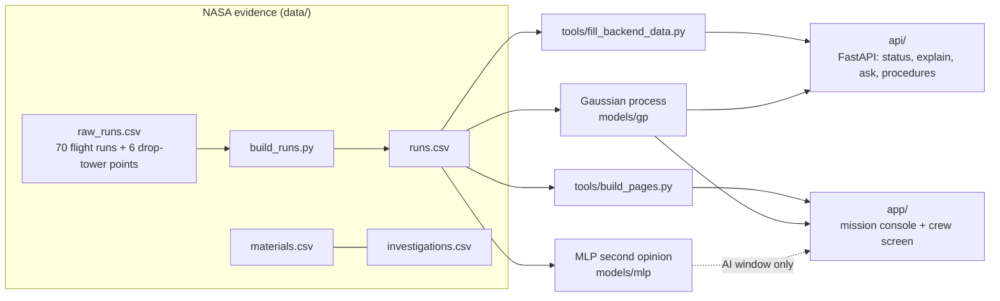

# PrF-G: Prevent Fire-Guard Neural Network

An onboard pre-fire margin assistant for crewed spacecraft and lunar habitats. PrF-G sits on top of existing cabin
telemetry, compares live conditions (O2, pressure, airflow, exposed materials, gravity) with NASA microgravity fire
experiments, and tells the crew in plain language what has changed, how far they are from tested conditions, and what
they could do. The crew decides; existing alarms and displays stay unchanged.

Built for NASA Space Apps 2026, challenge "Flame in Freefall", special mission "Build a Safe Onboard & Mission Control
Assistant".

## How it fits together



## Repository layout

| Path | What it is | Owner |
| --- | --- | --- |
| `frontend/` | **Demo app (React + TypeScript).** Full-screen simulated launch with the PrF-G dashboard; talks to `api/` and falls back to its on-board engine. See `frontend/README.md`. | P4 |
| `app/` | Earlier HTML pages. `mission_template.html` (full-screen mission demo with the PrF-G dashboard) and `prfg_template.html` (single crew screen with mission setup). Built pages are generated next to them. | P4 |
| `api/` | FastAPI backend: `/index`, `/evidence`, `/telemetry`, `/whatif`, `/explain`, `/ask`, `/procedures`, `/rank`. 46 automated checks in `test_api.py`. | P4 |
| `data/` | The evidence base: run-level data, derived variables, materials, investigations, reference atmospheres, screening bands. `build_runs.py` rebuilds `runs.csv`. | P1 |
| `models/gp/` | Fitted Gaussian process (39 BASS-II PMMA segments, held-out error about x1.25). | P2 |
| `material_intelligence/` | P3's neural network (NumPy MLP, sustained burning yes/no) with training, grouped cross-validation and safe-format artifacts. `python3 tools/sync_mlp_artifacts.py` copies a newly trained model into the API. | P3 |
| `models/mlp/` | Neural-network training set, baseline and the drop zone for P3's exported weights. | P3 |
| `research/p2/` | P2's independent BASS-II transcription and first model. | P2 |
| `docs/` | `STUDIES.md` (every NASA source and what it gives), `DECISIONS.md` (why the design is what it is). | P1 |
| `tools/` | Build scripts that turn `data/` into the backend files and the app pages. | P4 |
| `archive/branch1/` | Dropped scientist-explorer pages, kept for reference. | |

## Run it

```bash
# 1. Rebuild derived data after editing data/raw_runs.csv
cd data && python3 build_runs.py && cd ..

# 2. Push the data into the backend
python3 tools/fill_backend_data.py api

# 3. Build the app pages (data and GP are embedded; they open as plain HTML files)
python3 tools/build_pages.py        # -> app/mission.html, app/crew_screen.html

# 4. Run the React demo app (optional: VITE_API_URL=http://localhost:8000 for the live backend)
python3 tools/export_frontend_data.py && cd frontend && npm install && npm run dev && cd ..

# 5. After retraining the MLP in material_intelligence/, copy it into the API
python3 tools/sync_mlp_artifacts.py

# 6. Run the backend
cd api && pip install -r requirements.txt && uvicorn app.main:app --reload   # http://localhost:8000/docs
python3 test_api.py http://localhost:8000                                   # 46 checks
```

Deploy the site to Cloudflare Workers: `cd frontend && npx wrangler login && npm run deploy` -> `https://prf-g.<subdomain>.workers.dev`
(main menu with Presentation / Repository / Live demo; proxies `/api/*` to the backend; details in `frontend/README.md`).
The presentation is read live from `presentation/` in this repo: upload `presentation.pdf` there and the site shows it.

Deploy: render.com -> New -> Blueprint -> select this repo (`render.yaml` builds `api/` and the static `frontend/`). The free plan sleeps after
about 15 minutes idle, so open `/docs` a minute before presenting.

## Data status

- 76 records, 72 verified with a source link. All BASS-II M1-M20 values match NASA Table 5.1.
- Values a source does not report stay empty and are never treated as a match.
- No partial-gravity fire data exists in NASA PSI; at lunar gravity PrF-G says "untested".
- Telemetry in the demo is simulated; the trajectory is an illustrative profile. Checklists are simulated, not NASA procedures.

## Team workflow

- Work on a branch, open a pull request, merge after `test_api.py` passes. No zips.
- `data-v1.0` tag = frozen data. After it, data changes only to fix an error confirmed against its source.
- Never commit `.venv/`, IDE folders, or `.joblib` / `.pkl` model files.
